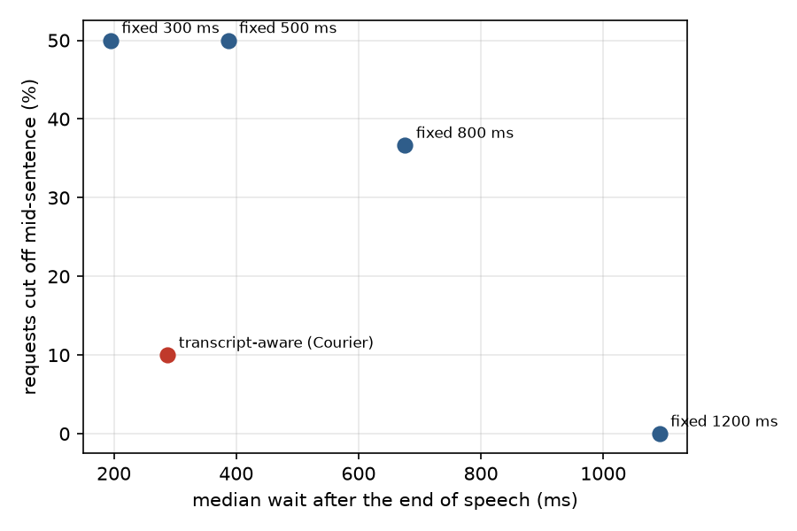
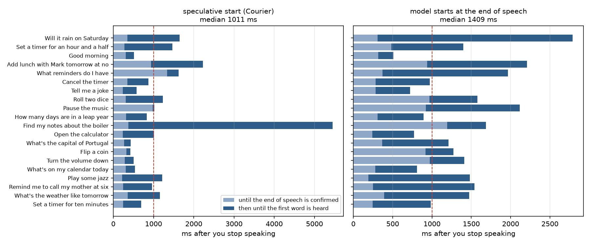
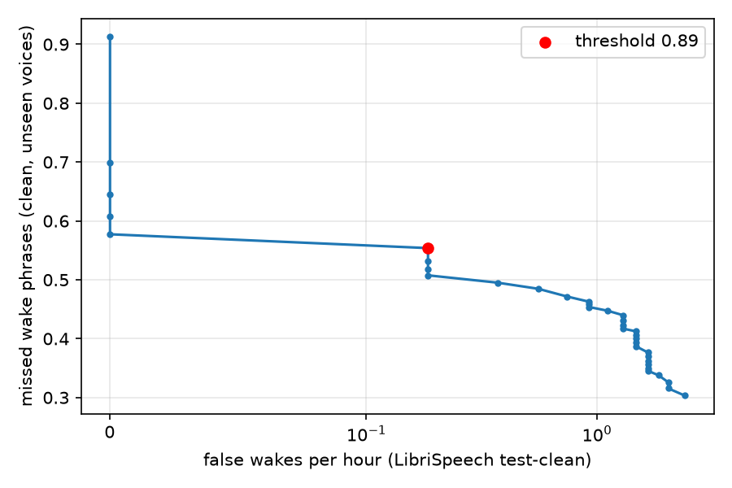

# Courier

A voice assistant that runs entirely on your computer. Say "Hey Courier", ask for something, and it
answers out loud: timers, reminders and alarms, your calendar, your files, music, the volume and
programs, the weather, or just a question. Nothing goes to a server: the wake word, speech
recognition (Whisper), the language model (Qwen2.5-3B with tool calling) and the voice (Piper) all run
locally. The weather is the only thing that uses the network, and only if you let it.

New commands are Lua files dropped into `plugins/`; the assistant notices them while it runs.

```
[   3.24] (wake word)
[   4.43]   ... Set a time for you. Set a time
[   5.41]   ... Set a time for 10 minutes.
[   5.76] you: Set a time for 10 minutes.
[   6.04]   -> set_timer {"duration":"10 minutes"}
[   6.04]   <- {"seconds":600,"ok":true,"say":"Timer set for 10 minutes.", ...}
[   6.22] courier: Timer set for 10 minutes.
[   8.10] (listening, no wake word needed)
```

This is `courier sim` on a recorded request. The speech ended at 5.41 s and the answer started 0.8 s
later. The live transcript (the "..." lines) is updated while you speak.

## How it works

```
microphone ─► 16 kHz ─► Silero VAD ─► endpointing ─► Whisper ─► Qwen2.5-3B ─┬─► Piper voice ─► speakers
                    └─► wake word                     (at the     (streams;  │      (a clause at a time)
                        (speech embedding +           first pause)  tool call └─► Lua plugin ─► result
                         small classifier)                          under a JSON grammar)
```

| Part | Language | Where |
|---|---|---|
| The engine: speech detection, the wake word detector, Whisper, the language model with its tool grammar, the voice | C++17 | [engine/](engine/) |
| The orchestrator: audio in and out, the conversation's state machine, endpointing, prompts, grounding, the plugin host, the evaluations | Rust | [courier/](courier/) |
| The tools | Lua | [plugins/](plugins/) |
| Training and evaluating the wake word | Python (PyTorch) | [wakeword/](wakeword/) |

Getting the first word out quickly is most of the work:

- **Endpointing that reads the transcript.** When you pause for 160 ms, the utterance so far is
  transcribed. A transcript that reads like a finished request ("Set a timer for ten minutes.")
  ends after 384 ms of silence. One that stops on a word needing more ("Remind me to ...") waits
  1.3 s. With no punctuation, it waits 1 s ([endpoint.rs](courier/src/endpoint.rs)).
- **A speculative start.** The model starts on that first transcript at once, before the end of
  speech is confirmed. Its words are held back and its tool calls are not run until the end is
  confirmed. If you go on speaking, that answer is cancelled ([dialog.rs](courier/src/dialog.rs)).
- **Streaming.**
  - Text streams out of llama.cpp, and the first clause is spoken while the rest is still being
    written ([speech.rs](courier/src/speech.rs)).
  - The system prompt with the 18 tools (about 2,000 tokens) is computed once at start-up and kept in
    the model's context cache. Each request only computes what is new.
- **Tools answer for themselves.** A tool's result may carry a sentence to say ("Timer set for 10
  minutes."). It is spoken as is, without a second generation.

The model is a 3B one. It chooses tools well and does arithmetic badly. So:

- **Plain words as arguments.** The tools take durations and days in the user's words ("an hour and
  a half", "friday"), and Lua works them out ([when.lua](plugins/lib/when.lua)).
- **Grounding.** Before a tool runs, its arguments are checked against what was said
  ([ground.rs](courier/src/ground.rs)):
  - a date the model computed is replaced by the day the user named;
  - a time or delay whose numbers the user never said is dropped, and the tool then asks.
- **A tool-call grammar.** Inside `<tool_call>`, a JSON-schema grammar allows only a call to one of
  the tools, with valid arguments ([llm.cpp](engine/src/llm.cpp)). Generation stops when that JSON
  closes.

Other details:

- **Whisper.**
  - It runs on the GPU with an encoder window cut to the audio's length.
  - Cut-off phrases sent it into loops ("Remind me too. Remind me too. ..." for 7 s). The number of
    tokens is now capped by the audio's length, and repeated runs are collapsed.
  - Transcripts lose the wake phrase and Whisper's "Thank you." for silence.
- **The voice.** Piper's LJSpeech voice reads phonemes from the CMU dictionary (no espeak).
  Numbers, times, dates, units and currencies are spelled out first ("6:30 PM" → "six thirty p m").
- **Barge-in.** The wake word interrupts an answer. While the assistant talks, the wake threshold
  is raised, so its own voice cannot wake it.
- **Follow-ups.** After an answer it keeps listening for 5 s without the wake word.
- **Music** is decoded with symphonia, mixed with the voice and ducked while the assistant listens
  or talks.

## Results

Every number comes from a command in this repository (files in [results/](results/)), measured on a
desktop with an RTX 2060 (6 GB).

### Tool calling

Requests in text, against all 18 tools.
[bench/tools.jsonl](bench/tools.jsonl) has 80 requests (67 needing a tool, 13 not); the system prompt
and the tool descriptions were tuned on it. [bench/tools-heldout.jsonl](bench/tools-heldout.jsonl)
has 40 more, written afterwards and never used to change anything. The tools run against a recorder,
so nothing on the computer is touched. A case counts as correct only if the right tool is called with
the right arguments, or no tool for a question.

| Model | Grammar | Tuned set | Held-out set | Time to a complete call (median / p90) |
|---|---|---|---|---|
| **Qwen2.5-3B Q4_K_M** | on | **0.96** | **0.80** | 613 / 852 ms |
| Qwen2.5-3B Q4_K_M | off | 0.96 | 0.78 | 558 / 866 ms |
| Qwen2.5-7B Q4_K_M | on | 0.85 | 0.70 | 1154 / 9386 ms |

- **The 7B model is worse here.** It often says it did something ("I rolled a die and got 4")
  instead of calling the tool. The prompt was tuned with the 3B model, which may favour it.
- **The grammar adds little.** Neither model wrote an invalid call without it. It is kept as a
  guarantee.
- **Mistakes on the held-out set:**
  - a missing label;
  - "half past four" as 14:30. Grounding dropped that time, and the assistant asked for one;
  - "this weekend", which the weather tool does not understand;
  - "play the one before" and "what does my day look like", which got the wrong tool or no tool.

Earlier versions, on the tuned set:

- **First prompt:** 0.86. The model computed dates and durations itself, for example "Saturday" as a
  Friday and "an hour and a half" as 900 seconds.
- **With the arguments in the user's own words** (durations, days): 0.96.

### Ending the turn

30 spoken requests, 15 of them with a 0.6–0.9 s pause in the middle ("Remind me to | call my sister
at six."). They are spoken by VCTK voices, with Silero VAD and Whisper as in the assistant
(`courier eval endpoint`).

| End of speech after | Cut off mid-request | Wait after the last word (median / p90) |
|---|---|---|
| 300 ms of silence | 15 / 30 | 195 / 238 ms |
| 500 ms of silence | 15 / 30 | 387 / 430 ms |
| 800 ms of silence | 11 / 30 | 676 / 718 ms |
| 1200 ms of silence | 0 / 30 | 1092 / 1134 ms |
| **Courier: depends on the transcript** | **3 / 30** | **288 / 929 ms** |



The three it still cuts are pauses where Whisper misheard the half-sentence as a finished one:
"Set a time of four." for "Set a timer for ...", and "What's on my schedule?" for "What's on my
schedule ... for tomorrow".

### From the end of speech to the first word

20 requests ([bench/latency.jsonl](bench/latency.jsonl)), each spoken by a different VCTK voice after
"Hey Courier". They are fed in real time, 12 s apart, through the whole assistant (`courier eval
latency`). Here the assistant is woken at the end of each wake phrase; the wake word is measured on
its own below.

| | Median | p90 | Under 1 s | Right tool (or none) |
|---|---|---|---|---|
| **Speculative start (Courier)** | **1011 ms** | 1646 ms | 50% | 17 / 20 |
| Model starts at the end of speech | 1409 ms | 2115 ms | 35% | 19 / 20 |



**The fast cases.** When a tool's result answers for itself (timers, the volume, the calendar,
reminders) or no tool is needed, the first word comes 0.4–1.0 s after you stop. That includes the
~300 ms wait to be sure you have stopped.

**The slow cases:**
- **A real disk search.** "Find my notes about the boiler" walked the actual Documents folders:
  5.4 s.
- **Tools that fail in this test.** The weather has no network here, and the music folder is
  unset. The model then speaks a second time about the error.

**The wrong tools** with speculation on:
- "Flip a coin" and "Roll two dice" were answered without the tool. The test is run without a
  history, and the speculative answer is the same request as without speculation, so this is the
  model's variance.
- "Add lunch with Mike tomorrow afternoon" was heard as "Mike" and "afternoon" and became a
  reminder.

### The wake word

The detector has three stages:

1. a mel spectrogram;
2. Google's speech embedding (frozen, Apache-2.0, as packaged by
   [openWakeWord](https://github.com/dscripka/openWakeWord)): 96 numbers every 80 ms, learned on a
   large amount of real speech;
3. a small classifier (275k parameters) over the last 16 embeddings.

**Training** used only synthetic speech: "Hey Courier" in several pronunciations (CUR-ee-er, COOR-ee-er, with and without the r), by 850
LibriTTS-R voices (Piper). The negatives were:
- other speech by the same voices and by real people (LibriSpeech dev-clean);
- look-alike phrases ("hey Courtney", "the courier is late");
- the phrase cut short;
- "courier" without "hey";
- noise;
- after a first model, the 2,000 windows of real and synthetic speech it scored highest.

Rooms, microphones and noise are simulated. The threshold (0.89) was chosen on 54 other LibriTTS-R
voices and 1.6 h of validation speech: 99.4% of their phrases at 0.63 false wakes per hour.

**On voices it never heard** (`python -m courier_wake.evaluate`, through the engine's streaming
detector), each phrase is followed by a request. Each recording is noted "clean" or "noisy room"
(reverberation, noise at 5–20 dB SNR):

| Test voices | Speakers | Found, clean | Found, noisy room |
|---|---|---|---|
| CMU ARCTIC | 18 | 0.81 | 0.75 |
| Joe | 1 | 0.95 | 0.78 |
| L2-ARCTIC (Arabic, Mandarin, Hindi, Korean, Spanish, Vietnamese accents) | 24 | 0.56 | 0.47 |
| Kristin | 1 | 0.38 | 0.48 |
| VCTK (British) | 109 | 0.38 | 0.37 |
| John | 1 | 0.23 | 0.23 |
| Bryce | 1 | 0.20 | 0.28 |
| Norman | 1 | 0.13 | 0.20 |
| Cori (British) | 1 | 0.05 | 0.13 |
| **All 1,448 phrases** | | **0.44** | **0.42** |

False wakes:

| Speech | False wakes |
|---|---|
| LibriSpeech test-clean (5.4 h, 40 real speakers) | 1 (0.19 per hour) |
| The same speech in a noisy room | 12 (2.2 per hour) |
| 724 look-alike phrases from the test voices | 6 |
| 1,086 ordinary requests from the test voices | 1 |



**This is the weakest part.** False wakes are rare, but on new voices it finds fewer than half of the
phrases, and some voices hardly ever. It also depends on how "Courier" is said: in the LJSpeech voice,
COOR-ee-er scores 0.98 and CUR-ee-er 0.04. At a lower threshold it finds more (0.61 at 0.5) for
1.5 false wakes an hour. Set it in `courier.toml` (`[wake] threshold`).

**What went wrong on the way:**
- **A detector that learned the synthesizer.** The first detector learned its own features from mel
  spectrograms (a DS-CNN), and it recognised the synthesizer rather than the phrase.
- **An evaluation bug.** The detector needs 2 s of audio before its first score, and test recordings
  that started 0.5 s before the phrase made it miss every phrase. A microphone that is already on
  never has that problem, so the evaluation now gives every phrase 2.5 s before it.
- **What would help most:** more than one synthesizer in training (only LibriTTS-R was used), and
  recordings of real voices.
  - [`record.py`](wakeword/courier_wake/record.py) and
    [`personalize.py`](wakeword/courier_wake/personalize.py) fine-tune the detector on your own voice
    (12 phrases and 12 sentences).
  - Their effect is not measured here.

## Tests

| What | Where | How many |
|---|---|---|
| Speech features (whole vs. streamed), the energy detector, text for the voice, UTF-8 streaming, Whisper's loops, Silero on speech, voice → Whisper round trip, the wake word on an unseen voice, the language model calling a tool under the grammar and reusing its cache | [engine/tests/engine_tests.cpp](engine/tests/engine_tests.cpp) | 46 checks |
| Endpointing, the dialog's state machine (speculation kept and dropped, tool calls, barge-in, alarms, timeouts), prompts, grounding, the resampler, the speech chunker, file search, the Lua host (validation, runaway plugins, alarms, reloading), evaluation matching | [courier/src](courier/src) | 47 |
| Every shipped plugin's own tests (durations, dates, ICS recurrence, timers, reminders, music search, weather text, ...) | `tests` in each [plugin](plugins/), run by [courier/tests/plugins.rs](courier/tests/plugins.rs) and `courier plugins --test` | 17 |
| Training windows, augmentation, streamed embeddings equal fresh ones, PyTorch = ONNX = the engine's detector | [wakeword/tests/test_wake.py](wakeword/tests/test_wake.py) | 7 |

CI ([.github/workflows/ci.yml](.github/workflows/ci.yml)):
- **Engine.** Built on the CPU on Linux and Windows and tested with Whisper base.en, the voice and
  Qwen2.5-0.5B.
- **Orchestrator.** Formatted, linted, tested and built on both systems, along with the plugins'
  tests.
- **End to end.** The whole assistant runs on "Hey Courier, flip a coin" on the CPU.
- **Wake word.** Its Python tests run on Linux.

The evaluations need the 3B and 7B models, the training voices and LibriSpeech, so they run locally:
[results/run-evals.cmd](results/run-evals.cmd).

## Using it

Requirements:
- Windows 10/11 (Linux works too; it is less tried);
- CMake ≥ 3.22 and Visual Studio 2022 (or GCC/Clang);
- Rust 1.85+;
- for the GPU: CUDA 13 and an NVIDIA card;
- for training: Python 3.14.

```bash
bash scripts/fetch-deps.sh --llm          # sources, onnxruntime, Whisper, Silero, the voice, Qwen2.5-3B (all checked by SHA-256)
scripts\build-cuda.cmd                    # the engine for an NVIDIA GPU (or: cmake -S engine -B engine/build && cmake --build engine/build --config Release)
cd courier && cargo build --release && cd ..
courier/target/release/courier run        # say "Hey Courier"
```

Other commands:

| Command | What it does |
|---|---|
| `courier chat` | Type instead of speaking (`--voice` to hear the answers). |
| `courier sim recording.wav` | Run it on a recording, in real time. |
| `courier say "text" --out file.wav` | Hear the voice. |
| `courier plugins --test` | List the tools and run the plugins' tests. |
| `courier devices` | Show the microphone and speakers it will use. |

Settings live in [courier.toml](courier.toml): your place (for the weather), the music folder, the
folders to search, the calendar file, whether the network may be used, and the wake threshold. On
Windows, clone into a short path (for example `C:\src\Courier`): llama.cpp's and whisper.cpp's build
trees are deep.

### Writing a plugin

A file in `plugins/` returns its tools. It is picked up while the assistant runs.
[dice.lua](plugins/dice.lua) is the smallest:

```lua
return {
  tools = {
    { name = "flip_coin", description = "Flip a coin.",
      parameters = { type = "object", properties = {} },
      run = function() return { say = math.random(2) == 1 and "Heads." or "Tails." } end },
  },
}
```

The `courier` table gives plugins:
- alarms (`courier.alarm`, kept on disk);
- storage (`courier.load` / `courier.save`);
- file search and listing;
- opening files and programs, media keys and locking the screen;
- music;
- HTTP (only when the network is allowed);
- JSON.

A plugin's `run` gets 10 s before it is stopped. Arguments are checked against its schema first.

### Training the wake word

```bash
bash scripts/fetch-deps.sh --train        # the training and test voices
cd wakeword && python -m venv .venv && .venv/Scripts/pip install -r requirements.txt --index-url https://download.pytorch.org/whl/cu128 --extra-index-url https://pypi.org/simple
.venv/Scripts/python -m courier_wake.synth       # synthetic speech (about 30 min)
.venv/Scripts/python -m courier_wake.train       # windows, two training rounds, the threshold (about 40 min)
.venv/Scripts/python -m courier_wake.evaluate    # the table above
.venv/Scripts/python -m courier_wake.record      # your voice, then: -m courier_wake.personalize --voice data/me
```

LibriSpeech dev-clean and test-clean go in `wakeword/data/librispeech/` (from
[openslr.org/12](https://www.openslr.org/12)).

## Limits

- **English only.** The voice, the dictionary that drives it and the wake word are English. Whisper
  and Qwen would understand Romanian, but the tools' words and the voice would not.
- **The wake word** is the weak part (see above).
- **No echo cancellation.** You cannot interrupt the assistant by speaking, only with the wake word.
  A speaker close to the microphone may hide the wake word.
- **The calendar** is local iCalendar files, not a synced account. Recurring events support common
  rules, not all of RFC 5545.
- **PC control** is Windows-first. On Linux, the volume and media keys go through `amixer` and
  `playerctl`.

## Licenses

The code is MIT ([LICENSE](LICENSE)). What it uses:

| Component | License |
|---|---|
| whisper.cpp, llama.cpp, miniaudio | MIT / public domain |
| onnxruntime | MIT |
| Whisper | MIT |
| Silero VAD | MIT |
| Google speech_embedding and the mel model ([models/wake/](models/wake/), via openWakeWord) | Apache-2.0 |
| Piper and the LJSpeech voice | MIT and public domain |
| LibriTTS-R and VCTK voices (training and tests) | CC BY 4.0 |
| CMU ARCTIC, single-speaker LibriVox voices (tests) | BSD-style / public domain |
| L2-ARCTIC voice (tests only, not shipped) | CC BY-NC 4.0 |
| CMUdict | BSD-style |
| LibriSpeech | CC BY 4.0 |
| Qwen2.5-3B-Instruct | Qwen Research License (not for commercial use; any instruction-tuned GGUF model can replace it) |
| Lua (mlua), cpal, symphonia | MIT / Apache-2.0 / MPL-2.0 |
